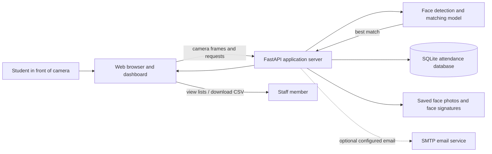

# Face Recognition Attendance — Project Guide

## What this project does

This project is a digital attendance register. A student looks at a camera, the software checks whether their face matches a previously registered student, and it records one attendance entry for that student on that date.

In simple terms: the camera collects a picture, the face model acts like an identity checker, and the database acts like the attendance book.

## A short explanation you can present

> “An administrator registers students and their face photos. When a faculty member signs in and opens the attendance kiosk, students can stand in front of its camera. The system compares each face with registered students and records attendance for a match. Faculty can use the kiosk; administrators manage student details and attendance records.”

The mathematical signature is often called a **face embedding**. It is a list of numbers that represents face features; it is not a person’s name and it is not a percentage-guarantee of identity.

## How one attendance check works

1. A faculty member opens the web dashboard and signs in with faculty credentials.
2. The faculty member opens the attendance kiosk; the browser asks permission to use the device camera.
3. The browser sends camera frames to the application server.
4. The server’s face-recognition model finds a face and makes its mathematical signature.
5. The server compares that signature with the registered students’ signatures.
6. If the closest match passes the configured similarity threshold, the server records attendance.
7. The dashboard shows the result; staff can review the attendance list or download a CSV file.

The app checks repeatedly while the faculty kiosk camera is on. It prevents a second automatic attendance entry for the same student on the same date. Students do not have accounts or access to the dashboard. Only an administrator can register students, edit records, configure email, export attendance, or use the database console.

## Architecture at a glance

### The main parts

- **Dashboard (the front desk):** Faculty use the attendance kiosk. Administrators see the additional student, attendance, settings, and report tools.
- **Application server (the coordinator):** Receives browser requests, checks sign-in, asks the recognition model to process faces, and reads or writes records.
- **Recognition model (the checker):** Detects faces and compares their signatures. The current web app uses InsightFace with ONNX Runtime and runs on the CPU.
- **Database and files (the filing cabinet):** SQLite holds student and attendance records. Other files hold registered face photos, saved signatures, and settings.
- **Optional email service:** If SMTP details are configured, the app can send email reports. Email is an add-on, not required for attendance.

## Registering a student

An administrator registers a student with their name, email, and face photo. The server saves the student details, stores the photo under `known_faces/`, and adds the face signature to `encodings.json`. Later kiosk checks compare against these saved signatures.

## What information is stored

The app’s data folder can contain:

- `attendance.db` — student details and attendance entries.
- `known_faces/` — registered face photos.
- `encodings.json` — saved face signatures used for matching.
- `config.json` — app and optional mail settings.

These files can identify people or contain biometric data. Keep the data folder private, restrict access, decide how long records are needed, and provide a non-face/manual attendance option where appropriate. The web app does not automatically delete old records on a schedule. The older command-line version has separate cleanup behavior; do not assume it applies to the web app.

## Important limits to explain honestly

- A match threshold is a tuning setting, not proof that recognition is always correct.
- The displayed match confidence is a similarity indicator, not a calibrated probability that the identity is correct.
- The project has no liveness check to determine whether a real person is in front of the camera rather than a photo or screen.
- Camera quality, lighting, pose, and the registered photos can affect matching.
- The project should be treated as a minor project/demo until it has been evaluated with representative users and safeguards. A manual attendance fallback is sensible.
- Face data is sensitive. Get appropriate consent, explain its use, secure access, and define deletion and retention practices before real-world use.

## Hosting and what “online” means here

There are two different deployment configurations in this project:

- **Temporary demo tunnel:** `run_online.py` can expose the running application on the developer’s computer through a temporary Cloudflare Quick Tunnel URL. That computer and its app/tunnel process must stay online. The URL can change after a restart. This is useful for a short demo, but it is not a permanently hosted service.
- **Render free demo configuration:** `render.yaml` describes a limited free service and disables face recognition because the free instance may not have enough memory for the model. Data on a free instance may not persist reliably. It is therefore not equivalent to a fully operational, durable attendance service.
- **Local/Docker setup:** `docker-compose.yml` is for running the app in Docker with a named data volume. It is useful for a controlled local setup; a volume on one machine is not automatically a cloud backup.

The address being reachable on another person’s device only means they can open the web page. For a reliable service, the server must remain running, use HTTPS, have enough memory for the recognition model, and use persistent protected storage with backups. Do not put passwords, app keys, face data, or student records in a public code repository.

## Repository file pointers

| File | What it is for |
|---|---|
| [`web_app.py`](web_app.py) | Main web server: authentication, model startup, API actions, matching, attendance, exports, optional mail, and static page delivery. |
| [`static/index.html`](static/index.html) | Structure and labels of the dashboard shown in the browser. |
| [`static/style.css`](static/style.css) | Dashboard appearance and layout. |
| [`static/app.js`](static/app.js) | Browser behavior: camera access, registration, sending frames to the server, and updating dashboard views. |
| [`attendance_system.py`](attendance_system.py) | Earlier command-line/local-camera version of the project. Useful for understanding the original workflow; it is not the web dashboard entry point. |
| [`run_web.py`](run_web.py) | Starts the web app locally for development or local use. |
| [`run_online.py`](run_online.py) | Starts the app and a temporary public tunnel for a demo. |
| [`requirements.txt`](requirements.txt) | Python libraries required by the project. |
| [`Dockerfile`](Dockerfile) | Instructions to package the app into a Docker container. |
| [`docker-compose.yml`](docker-compose.yml) | Runs the container locally and connects a named data volume. |
| [`docker-entrypoint.sh`](docker-entrypoint.sh) | Prepares the container’s data folder and starts the app with the configured user. |
| [`render.yaml`](render.yaml) | Render service settings for the limited free demo deployment. |
| [`README.md`](README.md) | Project overview and general setup instructions. |
| [`DEPLOYMENT.md`](DEPLOYMENT.md) | Deployment options and setup notes. |
| [`QUICK_TUNNEL.md`](QUICK_TUNNEL.md) | Notes for using the temporary Cloudflare tunnel demo. |
| [`REPORT_REVIEW.md`](REPORT_REVIEW.md) | Review notes about the project report and differences/limits in the implementation. |

## A simple analogy

Think of it as a school reception desk:

- The **web page** is the desk where the staff member operates the system.
- The **camera** is the sign-in point.
- The **recognition model** is the staff member checking a face against registered records.
- The **database** is the attendance book.
- The **CSV export** is a copy of the register that can be opened in a spreadsheet.
- The **server** is the office behind the desk that coordinates each step.

The analogy is only for explaining the flow; the model can make mistakes and should not be treated as a human-level identity check.
